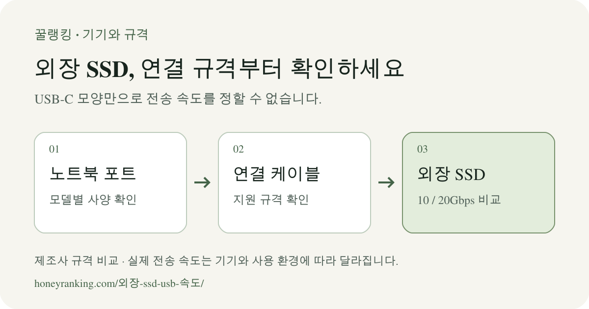

**외장 SSD를 고를 때는 노트북의 정확한 USB 전송 규격부터 확인하세요.** 아래 세 모델 중 삼성 T7과 Kingston XS1000은 USB 10Gbps, 삼성 T9는 USB 20Gbps 규격을 사용합니다. T9의 표기 속도를 활용하려면 노트북 포트와 케이블도 USB 3.2 Gen 2x2를 지원해야 합니다.

USB-C는 커넥터 모양을 가리킵니다. 같은 모양의 포트와 케이블이라도 지원하는 전송 규격이 다를 수 있습니다. [USB-IF의 커넥터·전송 규격 안내](https://www.usb.org/sites/default/files/usb_type-c_language_product_and_packaging_guidelines_20230320.pdf)를 바탕으로, 구입 전에 대조할 항목을 정리했습니다.

<figure>

<figcaption>노트북 → 케이블 → SSD 순서로 규격을 확인합니다. 그림은 확인 절차이며 실제 전송 속도 측정값이 아닙니다.</figcaption>
</figure>

## 2TB 모델 3종의 연결 규격과 크기

아래 수치는 **제조사가 공개한 규격**입니다. 꿀랭킹의 실측 성능이나 사용 후기, 판매 순위를 뜻하지 않습니다. 같은 제품군도 용량에 따라 수치가 달라질 수 있어 2TB 모델로 통일했습니다.

<table>
<caption>공식 자료 확인: 2026년 11월 5일. 읽기·쓰기는 제조사 표기 최대 순차 속도입니다.</caption>
<thead><tr><th scope="col">2TB 모델</th><th scope="col">USB 연결 규격</th><th scope="col">읽기 / 쓰기 MB/s</th><th scope="col">본체 크기 mm</th><th scope="col">본체 무게</th></tr></thead>
<tbody>
<tr><th scope="row">삼성 T7 <small>MU-PC2T0T/WW · 타이탄 그레이</small></th><td>USB 3.2 Gen 2 10Gbps</td><td>최대 1,050 / 1,000</td><td>85 × 57 × 8</td><td>약 58g</td></tr>
<tr><th scope="row">삼성 T9 <small>MU-PG2T0B/WW · 블랙</small></th><td>USB 3.2 Gen 2x2 20Gbps</td><td>최대 2,000 / 1,950</td><td>88 × 60 × 14</td><td>약 122g</td></tr>
<tr><th scope="row">Kingston XS1000 <small>SXS1000/2000G · 블랙</small></th><td>USB 3.2 Gen 2 10Gbps</td><td>최대 1,050 / 1,000</td><td>69.54 × 32.58 × 13.5</td><td>28.7g</td></tr>
</tbody></table>

T9의 **2TB 모델 쓰기 속도는 최대 1,950MB/s**입니다. 같은 자료에서 4TB에 표시한 2,000MB/s를 2TB 수치로 옮기면 안 됩니다. 삼성은 정확한 무게가 용량에 따라 달라질 수 있다고 안내합니다. 세 제품 모두 실제 속도는 연결 기기·케이블·사용 환경에 따라 달라집니다. 삼성은 T7·T9의 최대 속도 조건으로 해당 USB 규격을 지원하는 호스트·케이블과 UASP 모드도 안내합니다.

[출처가 포함된 비교 수치 CSV 내려받기](/assets/data/portable-ssd-usb-20261105.csv) · [연결 규격 확인 그림 PNG](/assets/images/ssd-usb-guide.png)

## 노트북 설명서에서 찾아볼 세 가지

1. **노트북 모델명과 사용할 포트 위치**를 확인합니다. 포트가 여러 개면 각 포트의 사양을 따로 읽습니다.
2. **데이터 전송 규격**을 확인합니다. `USB 3.2 Gen 2 / 10Gbps`인지, `USB 3.2 Gen 2x2 / 20Gbps`인지 적어 두세요. 충전 출력인 W 수치와 데이터 전송 속도인 Gbps는 구분합니다.
3. **케이블·허브의 지원 규격**을 확인합니다. 제조사가 제공한 케이블의 용도와 단자를 대조하고, 허브를 사용할 경우 허브의 호스트 연결과 SSD를 꽂을 포트까지 확인합니다.

설명서에 USB-C, USB4 또는 Thunderbolt라고만 적혀 있다면 **이 글만으로 T9의 USB 3.2 Gen 2x2 동작을 확정하지 않습니다.** 노트북 제조사의 해당 모델 지원 문서에서 Gen 2x2 지원 여부를 확인하세요. 운영체제 이름만으로 모든 Mac이나 Windows 노트북의 연결 속도를 묶어 판단할 수는 없습니다.

## 어떤 조건에서 비교하면 좋을까요?

<table>
<caption>다음은 위 규격을 적용한 선택 기준입니다. 제품별 실측 속도나 우열 판정은 아닙니다.</caption>
<thead><tr><th scope="col">확인한 사용 조건</th><th scope="col">비교할 부분</th><th scope="col">구매 전에 남은 확인</th></tr></thead>
<tbody>
<tr><th scope="row">노트북이 USB 10Gbps를 지원</th><td>T7·XS1000의 연결 규격과 크기·무게를 비교할 수 있습니다. T9는 포트가 지원하지 않는 20Gbps 조건을 활용할 수 없습니다.</td><td>현재 선택한 2TB 옵션, 제공 케이블, 보증·판매 조건</td></tr>
<tr><th scope="row">USB 3.2 Gen 2x2 20Gbps 지원을 확인</th><td>T9의 20Gbps 연결을 검토할 수 있습니다. 최대 속도는 제조사 시험 조건의 수치입니다.</td><td>연결 케이블도 Gen 2x2를 지원하는지, 실제 작업·저장 환경</td></tr>
<tr><th scope="row">휴대 크기와 무게가 중요</th><td>XS1000은 표의 세 모델 중 가볍고, T7은 두께가 가장 얇습니다.</td><td>케이블과 파우치까지 넣을 수납 공간</td></tr>
<tr><th scope="row">포트 규격을 아직 모름</th><td>모델명과 설명서부터 확인합니다. USB-C 모양이나 충전 출력으로 속도를 정하지 않습니다.</td><td>제조사 지원 문서의 정확한 포트 사양</td></tr>
</tbody></table>

## 케이블 구성도 확인하세요

- **T7·T9:** 공식 자료에는 USB C-to-C와 C-to-A 케이블이 포함되어 있습니다. T9의 20Gbps 사용 조건은 호스트와 연결 케이블의 Gen 2x2 지원을 따로 확인해야 합니다.
- **XS1000:** 현재 공식 데이터시트는 USB C-to-A 케이블과 A-to-C 어댑터를 안내합니다. 판매자가 제공하는 묶음과 동봉품이 같은지 확인하세요.

단자 변환 어댑터가 있다는 사실만으로 노트북의 전송 규격이 높아지지는 않습니다. 케이블을 추가로 살 때는 충전 출력과 함께 데이터 전송 규격이 명시되어 있는지 확인하세요.

## 가격 비교 전에 모델번호를 맞추세요

이 글은 연결 규격과 휴대 조건을 비교합니다. 현재 판매 가격·재고·국내 유통 옵션은 확인하지 않아 가격 순위를 매기지 않았습니다. 주문 화면에서는 위 모델번호와 **2TB 용량**, 국내·해외 유통 구분, 보증 적용 조건을 확인하세요.

HDD와 SSD 중 어떤 종류부터 고를지 정하지 않았다면 [외장 저장장치의 종류와 백업 용도 비교](/2026-01-외장하드/)를 먼저 보세요. 다른 기기의 규격 확인은 [기기·규격 구매 가이드](/guides/device/)에서 이어서 확인할 수 있습니다.

## 자주 묻는 질문

### USB-C 포트면 20Gbps SSD를 고르면 되나요?

포트 모양만으로 판단할 수 없습니다. 노트북의 정확한 USB 규격과 케이블을 함께 확인해야 합니다. USB-IF도 USB-C 커넥터와 USB 데이터 전송 규격을 구분해 안내합니다.

### T9 2TB도 쓰기 속도가 2,000MB/s인가요?

확인한 공식 데이터시트에서 T9 2TB의 최대 순차 쓰기는 **1,950MB/s**, 4TB는 2,000MB/s입니다. 둘을 같은 수치로 비교하지 않습니다.

### 표기 속도로 파일 복사 시간을 계산해도 되나요?

이 표의 최대 순차 속도만으로 실제 파일 복사 시간을 보장할 수는 없습니다. 제조사도 호스트·케이블·사용 환경에 따른 차이를 안내합니다. 구입 판단에는 지원 규격을 사용하고, 작업 시간은 같은 환경에서 측정한 자료가 있을 때 따로 비교하세요.

## 자료와 확인 범위

**규격 확인일: 2026년 11월 5일.** 가격 수집일이나 실제 성능 시험일이 아닙니다. 모델별 표는 아래 공식 자료에 근거하며, 조건별 선택표는 그 수치를 적용한 꿀랭킹의 설명입니다.

- [삼성 T7 2TB MU-PC2T0T/WW 공식 사양](https://www.samsung.com/sg/business/memory-storage/portable-ssd/portable-ssd-t7-mu-pc2t0t-ww/): 연결 규격·순차 속도·크기·무게·동봉 케이블과 성능 조건.
- [삼성 T9 공식 데이터시트](https://download.semiconductor.samsung.com/resources/data-sheet/samsung_portable_ssd_t9_datasheet_rev1_0.pdf): 3쪽의 용량별 규격, 4쪽의 모델코드와 동봉품. [삼성 공식 발표의 연결 조건](https://news.samsung.com/sg/samsungs-portable-ssd-t9-empowers-professionals-with-exceptional-performance-and-data-reliability)도 참고했습니다.
- [Kingston XS1000 공식 데이터시트](https://www.kingston.com/datasheets/SXS1000_en.pdf): SXS1000/2000G, 규격·무게·동봉품·호스트 조건.
- [USB-IF 커넥터·전송 규격 안내](https://www.usb.org/sites/default/files/usb_type-c_language_product_and_packaging_guidelines_20230320.pdf): 커넥터 모양, 전송 규격과 케이블의 차이.

출처 링크는 제조사·표준화 단체 자료로 연결됩니다. 꿀랭킹의 [자료 확인 및 제휴 기준](/methodology/)에서 다른 비교 글의 작성 방식도 확인할 수 있습니다.

